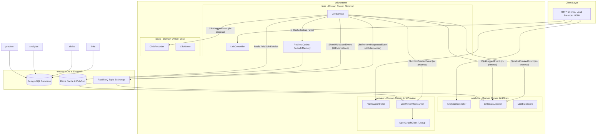

# Peer Presentation Guide & Defence Script (10 December)

This document contains the complete preparation, visual diagrams, speaking points, and live demo script for the **5-minute peer presentation** and oral defense.

---

## 1. Timing & Structure (5-Minute Outline)

| Minute | Topic | Key Speaker Goal |
| :--- | :--- | :--- |
| **0:00 - 1:15** | **High-Level Architecture & Event Flows** | Explain Modulith modularity, hexagonal boundaries, and asynchronous integration events. |
| **1:15 - 2:00** | **Work Distribution & Feature Ownership** | Present team roles, feature ownership, weights, and agreement budget compliance. |
| **2:00 - 3:00** | **Integration & Testing Strategy** | Show QA gates (`./gradlew check`), `ModularityTests`, Testcontainers integration, and k6 concurrency. |
| **3:00 - 4:15** | **Live Demo on Compose Load Balancer** | Execute the live demo across replicas (`POST /api/link`, `GET /{hash}`, `GET /api/stats`, `deactivate`, `preview`). |
| **4:15 - 5:00** | **Objective Review & Conclusions** | Summarize delivery against agreement cards (Level 4 scalability, 0 failures, 100% green). |

---

## 2. High-Level Architecture: Modules & Event Flows

The system is built as a **Spring Modulith** with semi-strict hexagonal architecture per module. Communication across module boundaries is strictly event-driven.

### Module Architecture (C4 Component Diagram)



### Integration Events Overview

| Event | Publisher | Consumers | Transport / Delivery |
| :--- | :--- | :--- | :--- |
| `ShortUrlCreatedEvent` | `links` (`LinkService.create`) | `analytics` (init stats), `preview` (init pending) | In-process transaccional listener |
| `ClickLoggedEvent` | `links` (`LinkService.redirect`) | `clicks` (append log), `analytics` (increment clicks) | In-process transactional listener with `eventId` deduplication |
| `ShortUrlUpdatedEvent` | `links` (`LinkService.deactivate`) | `links` (Redis Pub/Sub cache eviction), `analytics` (mark `active: false`) | Redis Pub/Sub (instant) + RabbitMQ durable topic queue (Level 4) |
| `LinkPreviewRequestedEvent` | `links` (`LinkService.create`) | `preview` (`LinkPreviewRequestedConsumer`) | RabbitMQ durable queue + Jsoup / Resilience4j circuit breaker |

---

## 3. Work Distribution & Feature Ownership

The project agreement allocates the full budget of **84 Fibonacci points** across grown features:

| Feature ID | Feature Title | Owner Module | Weight | Level | Status / Delivery |
| :---: | :--- | :---: | :---: | :---: | :--- |
| **0001** | Create Short URL (Seed) | `links` | 0 | Seed | Delivered & Verified |
| **0002** | Redirect & Click Log (Seed) | `links` + `clicks` | 0 | Seed | Delivered & Verified |
| **0003** | Link Stats (Seed) | `analytics` | 0 | Seed | Delivered & Verified |
| **0004** | Link Preview / Open Graph | `preview` | **21** | Level 4 | **Delivered 100%** (RabbitMQ broker, Jsoup, CircuitBreaker) |
| **0005** | CSV Upload | `links` | 13 | Level 3 | Catalog agreement card |
| **0006** | Redirect Cache Cross-Replica | `links` | **21** | Level 4 | **Delivered 100%** (Redis shared cache + Pub/Sub + RabbitMQ) |
| **0007** | QR Code Generation | `links` | 8 | Level 2 | Catalog agreement card |
| **0008** | Async Click Ingestion | `clicks` | 21 | Level 4 | Catalog agreement card |

**Agreement Rules Summary:**
- Total weight: **84 / 84** (100% budget used).
- Grown features: **5** (exceeds requirement $\ge 4$).
- Event-coupled features: **4** (exceeds requirement $\ge 2$).

---

## 4. Integration and Testing Approach

The project enforces quality at every layer via automated QA gates:

1. **Architecture & Modularity Verification:**
   - `ModularityTests`: Enforces strict module isolation via `ApplicationModules.of(Application::class.java).verify()`.
   - `HexagonalArchitectureTests`: Validates jMolecules hexagonal stereotypes (`SEMI_STRICT`) ensuring domains and applications never leak adapter dependencies.
2. **Quality Gates (`./gradlew check`):**
   - **ktlint**: Static style and formatting compliance.
   - **detekt**: Static code analysis and code smell detection.
   - **JaCoCo**: Automated code coverage check ($\ge 60\%$ hard requirement).
3. **Integration & Concurrency Tests:**
   - `LinkDeactivationTests`: Token verification (`X-Admin-Token`), idempotent deactivation, cache invalidation, and 404/401 handling.
   - `ShortUrlUpdatedBrokerTests`: Asynchronous event delivery over Testcontainers RabbitMQ.
   - `LinkPreviewBrokerTests`: End-to-end broker-backed Open Graph metadata fetching.
   - Concurrency tests against PostgreSQL via Testcontainers.
4. **Load & Scalability Verification:**
   - k6 load test script (`scripts/load.k6.js`) executed across multiple virtual users with 0 failed checks.

---

## 5. Live Demo Script (Step-by-Step)

Run this sequence on the Compose load balancer (`http://localhost:8080`):

```bash
# 1. Start the complete multi-replica product stack
docker compose up --build -d

# 2. Create a short URL (Returns 201 Created with JSON hash)
curl -i -X POST http://localhost:8080/api/link -d "url=https://example.com"
# Example output: {"url":"http://localhost:8080/f","hash":"f"}

# 3. Follow redirect (Returns 307 Temporary Redirect -> 200 OK Example Domain)
curl -i -L http://localhost:8080/f

# 4. Check Link Stats (Returns 200 OK with totalClicks: 1, active: true)
curl -i http://localhost:8080/api/stats/f

# 5. Check Open Graph Link Preview (Feature 0004 - Returns 200 OK with READY metadata)
curl -i http://localhost:8080/api/preview/f

# 6. Deactivate URL with Admin Token (Feature 0006 - Returns 204 No Content)
curl -i -X POST http://localhost:8080/api/link/f/deactivate \
  -H "X-Admin-Token: test-admin-token"

# 7. Verify Redirect Invalidation (Returns 404 Not Found from cache & database)
curl -i http://localhost:8080/f

# 8. Verify Stats reflect deactivation (Returns active: false, totalClicks: 1 preserved)
curl -i http://localhost:8080/api/stats/f
```

---

## 6. Objective Review Against Agreement

- **Engineering Quality:** Hard gates green (`./gradlew check` passes, AI disclosures filed, ADRs 0004 and 0005 registered).
- **Scalability Level 4:** Verified with two application replicas (`app1`, `app2`), Redis shared cache + Pub/Sub, durable RabbitMQ broker, and Nginx load balancer.
- **Modularity:** 0 boundary leaks; clean hexagonal design verified by ArchUnit and Spring Modulith.
