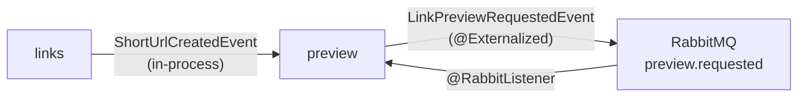

# ADR 0004: Link preview module and broker-backed fetch

- **Status:** Accepted
- **Date:** 2026-10-17
- **Deciders:** Feature card [0004](../features/0004-link_preview_open_graph.md)

## Context

Feature 0004 stores an Open Graph preview for each short URL and serves it from `GET /api/preview/{hash}`. The hash and the target URL are owned by `links` and are announced with `ShortUrlCreatedEvent` after the short URL is committed. Preview data must not be read from `short_url`, and the fetch must not run on `POST /api/link` or on `GET /{hash}`.

The feature weight is 21, so the fetch has to cross JVM boundaries and survive a restart. The Compose broker profile starts RabbitMQ, and the applications are not connected to it yet. Both replicas already share one Postgres database.

## Decision

1. Add a Modulith module `es.unizar.urlshortener.preview`. It keeps the seed hexagon (`SEMI_STRICT`, jMolecules stereotypes). Its public type is `LinkPreviewRequestedEvent` in the module base package, with `hash`, `target`, and `eventId`.
2. A listener in `preview` consumes `ShortUrlCreatedEvent` by importing only that type. It inserts one `link_preview` row in `PENDING` state and then publishes `LinkPreviewRequestedEvent`. A repeated creation event for the same hash does not insert a second row and does not publish a second request.
3. Externalize `LinkPreviewRequestedEvent` to RabbitMQ after commit, using the existing `--profile broker` service. A consumer in `preview`, running on whichever replica receives the message, fetches the target page and updates that same Postgres row to `READY` or `FAILED`.
4. Fetch with Jsoup (HTTPS, redirects, timeout, maximum body size). Prefer `og:title`, `og:image`, and `og:url`; fall back to the document `<title>`. Wrap the call in a Resilience4j circuit breaker. After repeated failures the row becomes `FAILED`. An already `READY` row is not fetched again.
5. Leave `POST /api/link` and `GET /{hash}` unchanged. If RabbitMQ or the target site is unavailable, link creation still returns 201 and the preview row stays `PENDING` or becomes `FAILED`. `GET /api/preview/{hash}` reads only `link_preview`: 404 Problem Details when the hash is unknown, 200 with `status` when the row exists.
6. `docker compose up --build` still starts without RabbitMQ. Completing previews requires `docker compose --profile broker up --build`, with both replicas on the Spring `broker` profile.

## Consequences

- The slow fetch is durable and can be completed by the replica that did not serve `POST /api/link`.
- `preview` never imports `links` internals. Both replicas see the row because they share Postgres.
- Local `bootRun` and the default Compose stack keep working without RabbitMQ. Previews stay incomplete until the broker profile is up.
- The feature card name `LinkPreviewFetchedEvent` described the result. The durable message is the request, so the event that crosses the broker is `LinkPreviewRequestedEvent`. The card is updated in a later commit so the defence text matches this ADR.
- Evidence below records the branch tests and the Compose broker run from 2026-10-18.

## Alternatives considered

| Option | Why rejected |
| --- | --- |
| Fetch inside `POST /api/link` before returning 201 | The client waits on the target site, a remote failure blocks creation, and HTTP leaves the `links` module. |
| Fetch inside the in-process `ShortUrlCreatedEvent` listener | The work dies with the JVM that handled creation. Weight 21 requires a broker. |
| Publish `LinkPreviewFetchedEvent` only after a local fetch | The durable message would be the result, so the download would still be tied to one replica. |
| Read `short_url` from `preview` | Cross-module access to another module's table. The creation event already carries `hash` and `target`. |

## Module diagram (Modulith)

Generated by `ModularityTests` → `Documenter.writeDocumentation()` into `build/spring-modulith-docs/`. Checked-in copies for the defence:

- [diagrams/0004-module-preview.puml](diagrams/0004-module-preview.puml) — Preview listens to Links
- [diagrams/0004-components.puml](diagrams/0004-components.puml) — all four modules
- [diagrams/0004-module-preview.adoc](diagrams/0004-module-preview.adoc) — base package `es.unizar.urlshortener.preview`; listens to `ShortUrlCreatedEvent` (async)

Regenerate: `./gradlew test --tests es.unizar.urlshortener.ModularityTests`

`preview` depends on `links` only by listening to its public event. It does not import `links` internals. The durable hop is `LinkPreviewRequestedEvent` on the broker.

## Evidence (defence)

- [x] Code on branch `feature/0004-link-preview` (module `preview`, ADR 0004, Compose broker wiring).
- [x] `./gradlew test --tests es.unizar.urlshortener.preview.*` including `LinkPreviewBrokerTests`; `docker compose up` without Rabbit still returns **201**; `docker compose --profile broker up` completes previews across replicas.
- [x] Modulith docs: `ModularityTests` writes `build/spring-modulith-docs/`; defence copies under [diagrams/](diagrams/) (`0004-module-preview.puml`, `0004-components.puml`, `0004-module-preview.adoc`).
