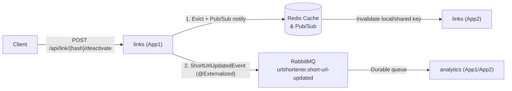

# ADR 0004: Shared Redis redirect cache and invalidation

- **Status:** Accepted
- **Date:** 2026-10-03
- **Deciders:** Team / feature card [0006](../features/0006-redirect_cache_cross_replica.md)

## Context

Each application replica serves `GET /{hash}`. An in-process cache can keep returning an outdated target after a link is deactivated on another replica. Redirect lookups are owned by `links`; deactivation must also persist so that a cache miss cannot make the link active again.

## Decision

1. Add an `active` state to `ShortUrl`; deactivation is persisted and idempotent. Redirect lookups exclude inactive records.
2. Keep cache access behind the `RedirectCache` secondary port. In Docker, store hash-to-target entries in Redis with an expiry. Outside Docker, use a process-local implementation so the existing HSQLDB development/test workflow needs no Redis service.
3. Publish `ShortUrlUpdatedEvent` only when deactivation changes state. Publish it in the service transaction and handle it after commit.
4. In Docker, relay the committed event hash over Redis Pub/Sub. Every replica subscribes and evicts the shared Redis key. The publishing replica also deletes that key in the after-commit listener, so the shared entry is gone before the HTTP response returns. Local development evicts directly after commit.
5. Expose `POST /api/link/{hash}/deactivate`. Require a non-empty, configured `X-Admin-Token`, compare tokens in constant time, and fail closed with 401 when absent or incorrect. Configure the token through `URLSHORTENER_ADMIN_TOKEN`; do not commit it.
6. `analytics` consumes `ShortUrlUpdatedEvent` and sets `LinkStats.active` without changing `totalClicks`. `GET /api/stats/{hash}` exposes `active`. Cache invalidation stays inside `links`.
7. Spring Modulith externalizes `ShortUrlUpdatedEvent` to the durable topic exchange `urlshortener.short-url-updated`. Messages are persistent. `links` and `analytics` each bind their own durable queue, so the modules stay isolated and a replica that is down receives the event when it returns. The JDBC publication registry retries a failed publish. RabbitMQ is part of the default Compose stack; Docker also invalidates the shared cache through Redis Pub/Sub.

## Consequences

- All replicas read the same cached value, and a committed deactivation invalidates it through the shared Pub/Sub channel.
- Deactivation crosses from `links` to `analytics` only through `ShortUrlUpdatedEvent`. Stats keep their click total and report the link inactive.
- Cache entries expire after the configured TTL even if a future invalidation is missed.
- Redis and a shared admin token are required for the Docker product deployment. The local profile remains self-contained but does not demonstrate cross-replica behavior.
- Redis Pub/Sub is transient. RabbitMQ also externalizes `ShortUrlUpdatedEvent` through a durable queue per module. A cache miss still checks the persisted inactive state if a message is delayed.
- Compose starts `app2` only after `app1` is healthy to avoid concurrent initialization of Spring Modulith's shared JDBC event-publication schema.

## Alternatives considered

| Option | Why rejected |
| --- | --- |
| In-process cache only | Replicas can continue serving stale targets and do not share cache entries. |
| TTL-only invalidation | Does not promptly invalidate deactivated links and misses the feature's cross-replica requirement. |
| Redis keyspace notifications | Requires server-side notification configuration and couples invalidation to Redis key-event settings. |
| Spring Cache abstraction | Adds indirection without benefit for the single string-valued redirect entry; direct Redis operations make key TTL and Pub/Sub behavior explicit. |
| Redis Pub/Sub as the Level 4 transport | Pub/Sub drops messages when a subscriber is offline, so it is not durable and does not give each module its own queue. |
| Keep `ShortUrlUpdatedEvent` inside `links` | `analytics` would keep describing a deactivated link as active. The read model for a hash belongs to `analytics`, and the allowed coupling is the event. |

## Module diagram (Modulith)

## Evidence (defence)

- [x] Code: `es.unizar.urlshortener.links.adapters.cache` (Redis/InMemory), `es.unizar.urlshortener.links.adapters.broker` (RabbitMQ TopicExchange), `es.unizar.urlshortener.links.adapters.web.LinkController` (`POST /api/link/{hash}/deactivate`).
- [x] Test / command: `./gradlew test --tests es.unizar.urlshortener.links.LinkDeactivationTests` and `./gradlew test --tests es.unizar.urlshortener.links.ShortUrlUpdatedBrokerTests`.
- [x] Compose runtime & k6: `docker compose up --build` with 2 app replicas (`app1`, `app2`), `redis`, `rabbit`, `db`, `lb`; k6 load test: 0 failed checks (100% success).
- [x] Modulith doc: `ModularityTests` passes `ensureHexagonal(SEMI_STRICT)` and `ApplicationModules.verify()`.
