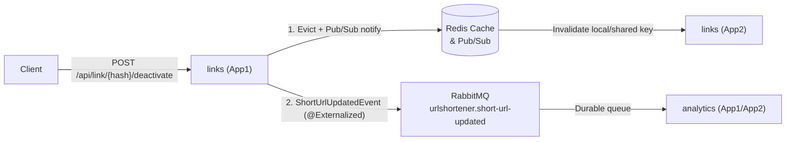

# ADR 0006: Shared Redis redirect cache and invalidation

- **Status:** Accepted
- **Date:** 2026-10-03
- **Revised:** 2026-11-21 — inactive-row HTTP contract and concurrent cache fills
- **Deciders:** Team / feature card [0006](../features/0006-redirect_cache_cross_replica.md)

## Context

Each application replica serves `GET /{hash}`. An in-process cache can keep returning an outdated target after a link is deactivated on another replica. Redirect lookups are owned by `links`; deactivation must also persist so that a cache miss cannot make the link active again.

The instructor requires 410 Problem Detail while a deactivated row remains, and
404 Problem Detail only when the hash is unknown or the row has been deleted.
Unknown hashes must not be negatively cached, so creating a previously missing
hash takes effect on its first subsequent redirect. Deactivation must take effect
on both replicas when its response returns, including while RabbitMQ is down.
An older cache miss must not repopulate a target after that invalidation.

## Decision

1. Add an `active` state to `ShortUrl`; deactivation is persisted and idempotent. Persistence lookups retain inactive records so the application can distinguish missing hashes (`LinkNotFoundException`, 404 Problem Detail) from inactive rows (`LinkGoneException`, 410 Problem Detail). Neither outcome is cached. Deleting an inactive row therefore changes the next response from 410 to 404.
2. Keep cache access behind the `RedirectCache` secondary port. In Docker, store hash-to-target entries in Redis with an expiry. Outside Docker, use a process-local implementation so the existing HSQLDB development/test workflow needs no Redis service.
3. Publish `ShortUrlUpdatedEvent` only when deactivation changes state. Publish it in the service transaction and handle it after commit. Repeated deactivation also evicts the cached target before returning, covering a previous transaction whose after-commit eviction is still pending without publishing a duplicate event.
4. In Docker, relay the committed event hash over Redis Pub/Sub. Every replica subscribes and evicts the shared Redis key. The publishing replica also deletes that key in the after-commit listener, so the shared entry is gone before the HTTP response returns. Local development evicts directly after commit.
5. Expose `POST /api/link/{hash}/deactivate`. Require a non-empty, configured `X-Admin-Token`, compare tokens in constant time, and fail closed with 401 when absent or incorrect. Configure the token through `URLSHORTENER_ADMIN_TOKEN`; do not commit it.
6. `analytics` consumes `ShortUrlUpdatedEvent` and sets `LinkStats.active` without changing `totalClicks`. `GET /api/stats/{hash}` exposes `active`. Cache invalidation stays inside `links`.
7. Spring Modulith externalizes `ShortUrlUpdatedEvent` to the durable topic exchange `urlshortener.short-url-updated`. Messages are persistent. `links` and `analytics` each bind their own durable queue, so the modules stay isolated and queued events survive a consumer outage. Replicas compete for each module's queue; delivery to every replica is not required because the Redis key and analytics storage are shared. The JDBC publication registry retries a failed publish. RabbitMQ is part of the default Compose stack; Docker also invalidates the shared cache through Redis Pub/Sub.
8. On a cache miss, load the row using `PESSIMISTIC_READ` and hold that database lock until the redirect transaction completes, including its cache write. A concurrent deactivation's update must wait for existing fills; its after-commit eviction therefore occurs after those fills. Cache hits remain database-free. This coordination is owned entirely by `links`.
9. Immediate redirect invalidation uses the originating replica's synchronous after-commit delete of the shared Redis key. It does not depend on RabbitMQ delivery or Pub/Sub timing. The configurable TTL controls entry lifetime and is not a substitute for invalidation. No reactivation endpoint is introduced; immediate activation means a newly created hash is available even after a previous miss.

## Consequences

- All replicas read the same cached value. Before a successful deactivation response returns, its after-commit listener deletes the shared key; Pub/Sub and broker delivery can repeat the eviction.
- Deactivation crosses from `links` to `analytics` only through `ShortUrlUpdatedEvent`. Stats keep their click total and report the link inactive.
- Cache entries expire after the configured TTL for storage management. Correctness after deactivation does not wait for that expiry.
- Redis and a shared admin token are required for the Docker product deployment. The local profile remains self-contained but does not demonstrate cross-replica behavior.
- Redis Pub/Sub is transient. RabbitMQ externalizes `ShortUrlUpdatedEvent` through a durable queue per module, while immediate redirect invalidation remains independent of broker availability. A cache miss checks persisted state and returns 410 for an inactive row.
- Cold redirects and deactivation coordinate through a database row lock. A deactivation may wait for an in-flight cold redirect transaction; an older fill cannot restore the previous 307 after deactivation has completed.
- An idempotent deactivation also removes the cached target before returning. It does not rely on another request having finished its after-commit listener and does not publish a second state-change event.
- Compose starts `app2` only after `app1` is healthy to avoid concurrent initialization of Spring Modulith's shared JDBC event-publication schema.

## Alternatives considered

| Option | Why rejected |
| --- | --- |
| In-process cache only | Replicas can continue serving stale targets and do not share cache entries. |
| TTL-only invalidation | Does not promptly invalidate deactivated links and misses the feature's cross-replica requirement. |
| Eviction without coordinating cache fills | A redirect that read an active row before deactivation can repopulate the old target after eviction, leaving a stale 307 until TTL expiry. |
| Validate persisted state on every cache hit | Adds a database lookup to every redirect. Locking cache-miss reads preserves database-free hits while coordinating fills with deactivation. |
| Broker-only invalidation | Delivery is asynchronous and can stop during an outage; the redirect contract must hold before broker recovery. |
| Redis keyspace notifications | Requires server-side notification configuration and couples invalidation to Redis key-event settings. |
| Spring Cache abstraction | Adds indirection without benefit for the single string-valued redirect entry; direct Redis operations make key TTL and Pub/Sub behavior explicit. |
| Redis Pub/Sub as the Level 4 transport | Pub/Sub drops messages when a subscriber is offline, so it is not durable and does not give each module its own queue. |
| Keep `ShortUrlUpdatedEvent` inside `links` | `analytics` would keep describing a deactivated link as active. The read model for a hash belongs to `analytics`, and the allowed coupling is the event. |

## Module diagram (Modulith)

## Evidence (defence)

- [x] Code: `es.unizar.urlshortener.links.adapters.cache` (Redis/InMemory), `es.unizar.urlshortener.links.adapters.broker` (RabbitMQ TopicExchange), `es.unizar.urlshortener.links.adapters.web.LinkController` (`POST /api/link/{hash}/deactivate`).
- [x] Revised HTTP and concurrency checks passed on 2026-11-21: `LinkDeactivationTests` (7), `RedirectCacheConcurrencyTests` (3 on HSQLDB), `RedirectCacheConcurrencyPostgresTests` (3) and `ShortUrlUpdatedBrokerTests` (1). The concurrency cases include idempotent deactivation while an earlier after-commit eviction is pending.
- [x] Revised product acceptance passed on 2026-11-21: `docker compose up --build -d --wait`, then `powershell -ExecutionPolicy Bypass -File scripts/test-redirect-cache.ps1`; covered both replicas, the load balancer, 404/410 Problem Detail, a previous miss followed by creation, and immediate invalidation with RabbitMQ stopped and restored afterwards. Active Redis entries still had 3596/3597-second TTLs; the complete post-deactivation verification phases took 2.64 seconds online and 2.60 seconds with RabbitMQ stopped, including HTTP probes and SQL checks.
- [x] Revised QA gate passed on 2026-11-21: `gradlew.bat check bootJar`; 81 tests, no skipped tests, failures or errors, with 566 of 566 lines covered (100%). `links` covers all 224 lines; `RedirectCacheRedisTests` adds five real-Redis checks for sharing, TTL, Pub/Sub and commit/rollback behavior. Overall branch coverage is 65 of 71 (91.55%). Both `ModularityTests` checks passed, including `ensureHexagonal(SEMI_STRICT)` and `ApplicationModules.verify()`.
- The complete product acceptance run was repeated against the rebuilt final images; overlapping idempotent deactivation is also covered by the passing HSQLDB and PostgreSQL concurrency tests.
- Historical evidence from 2026-10-17: the Compose product and k6 run passed with 0 failed load checks. The retained inactive rows then returned 404, so that run does not validate the corrected 410 contract. See feature card 0006 for the original observations.
